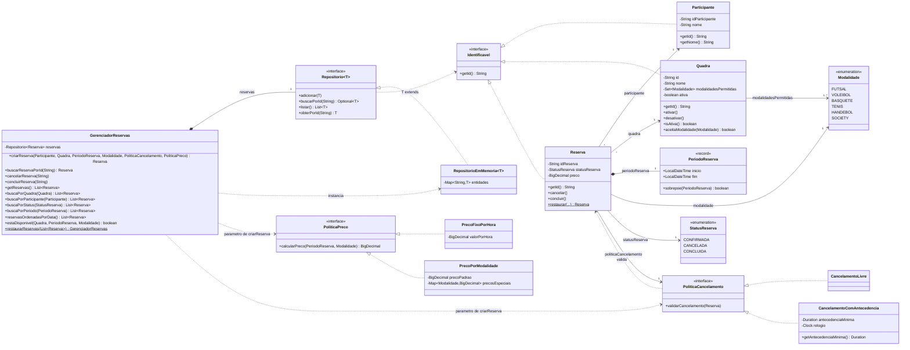
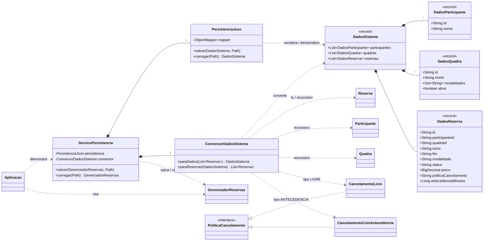
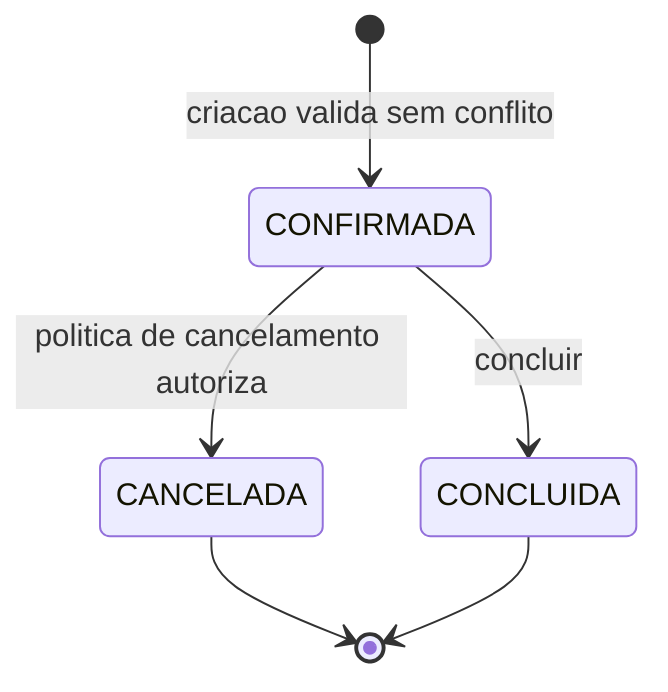

# Diagrama de classes — Checkpoint 3

O diagrama representa o código do Checkpoint 3. As relações de dependência entre
camadas são mostradas separadamente das associações do domínio para facilitar a leitura.
Setas contínuas (`-->`, `*--`) indicam campos da classe; setas tracejadas (`..>`)
indicam dependências de uso (parâmetros, instanciação).

## Domínio, políticas, repositório e serviço

> Observação: o preço final (`BigDecimal`) é armazenado em `Reserva`; a política
> de preço é utilizada ao criar a reserva, mas não fica associada a ela. Já a
> política de cancelamento é guardada na reserva, pois é consultada em `cancelar()`.

## Persistência e infraestrutura

**Fronteira arquitetural:** as classes de persistência dependem de tipos do
domínio, e as entidades do domínio (`Participante`, `Quadra`, `Reserva`,
`PeriodoReserva`) não importam Jackson, `Files` ou `Path`. A exceção é
`Aplicacao`, o ponto de entrada de demonstração, que está no pacote `dominio` e
usa `ServicoPersistencia` e `Path`. A estratégia de cancelamento salva é
reconstituída pelo conversor por um identificador de tipo conhecido (`LIVRE` ou
`ANTECEDENCIA`); por isso o conversor depende das duas implementações.

## Estados da reserva

Canceladas liberam o intervalo; confirmadas e concluídas impedem reservas
sobrepostas da mesma quadra. Estados terminais não retornam a `CONFIRMADA`:
tentativas de nova transição lançam `TransicaoReservaInvalidaException`.
