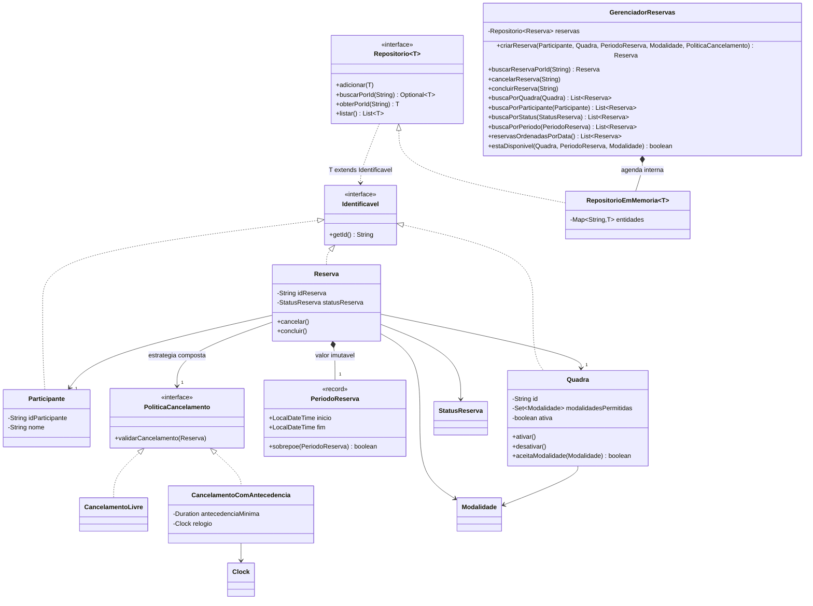
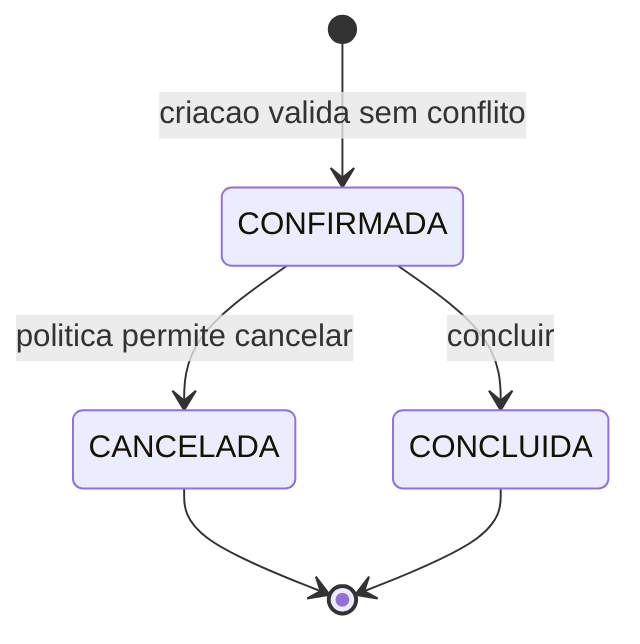

# Diagrama da evolução

Participantes e quadras são entidades compartilhadas: não são destruídos quando
uma reserva muda de estado. A composição comportamental está na política de
cancelamento recebida por `Reserva`; a mesma interface admite novas estratégias.
O repositório genérico é usado com `Participante`, `Quadra` e `Reserva`.

Não há retorno a `CONFIRMADA`. Tentativas de nova transição a partir dos estados
terminais lançam `TransicaoReservaInvalidaException`. Os registros terminais
permanecem no histórico; somente `CANCELADA` deixa de bloquear o intervalo.
